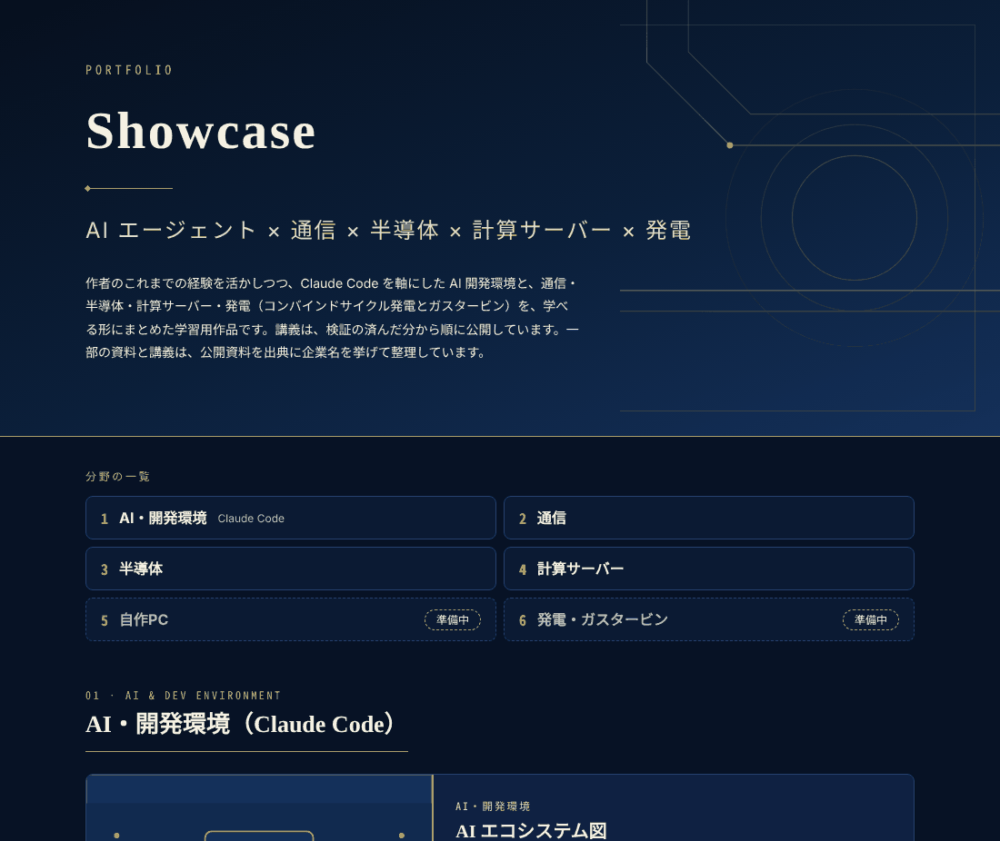
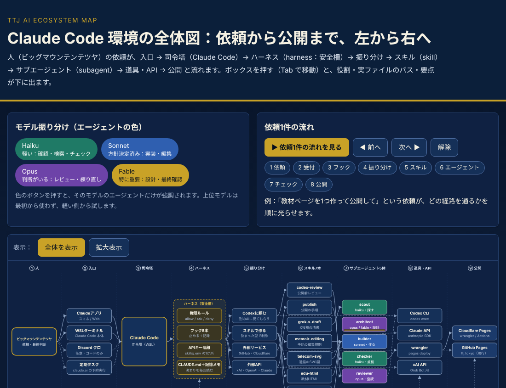
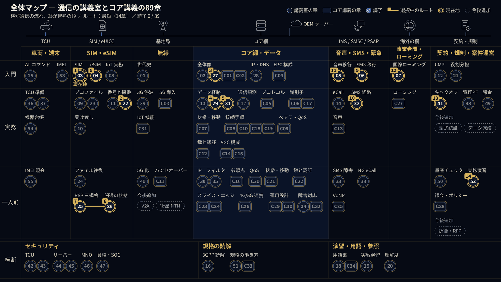
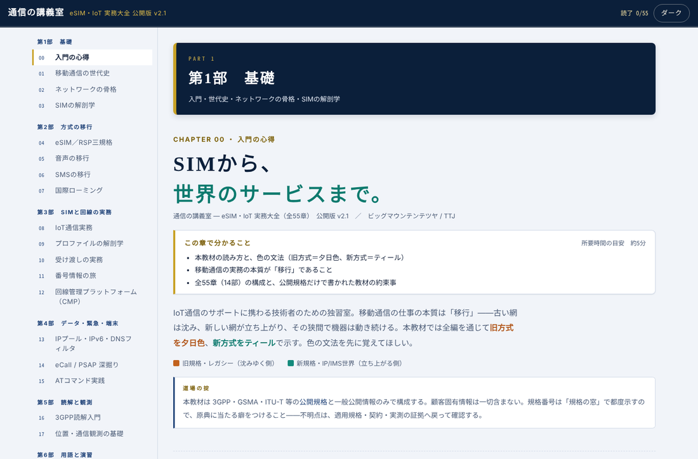
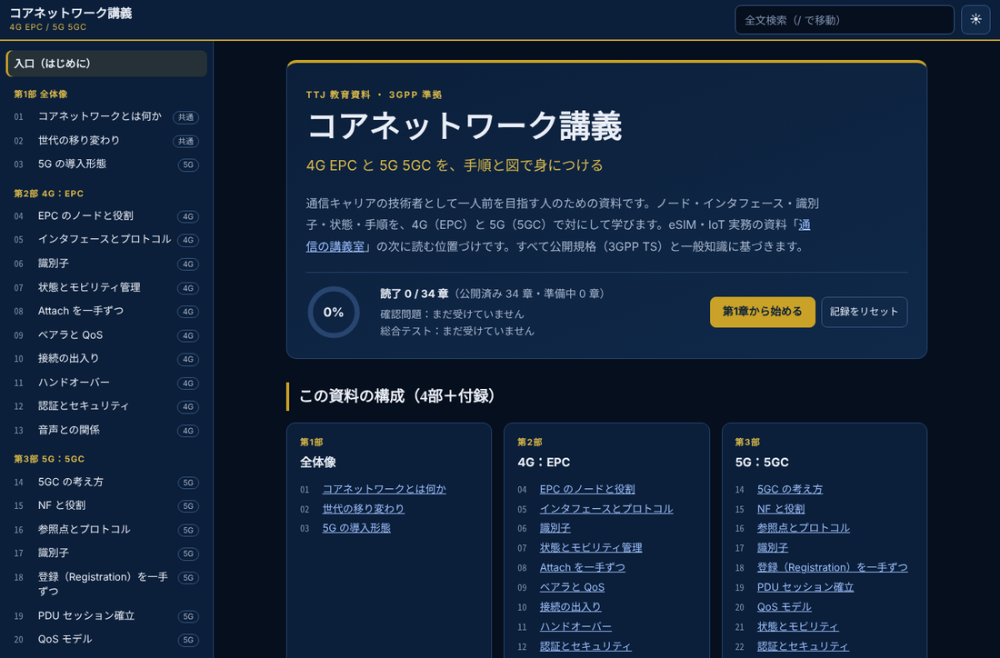
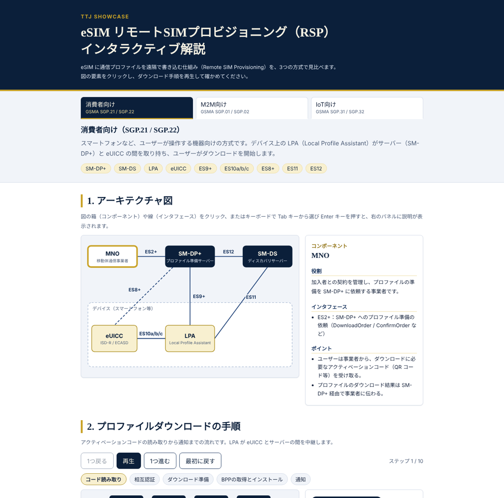
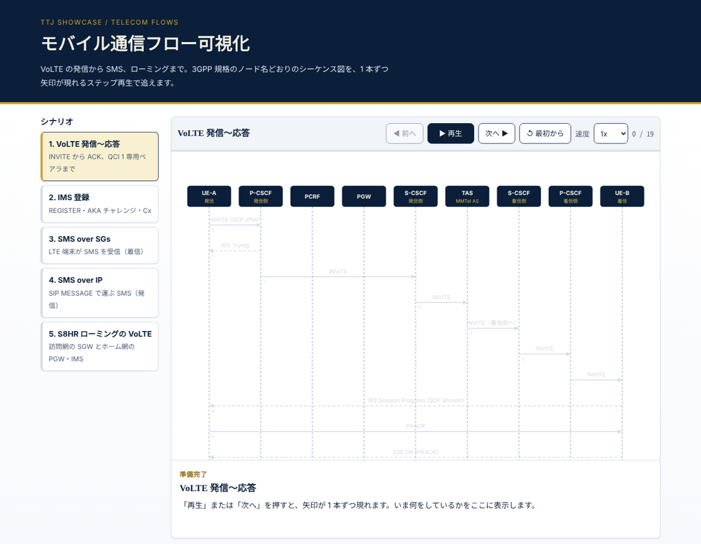
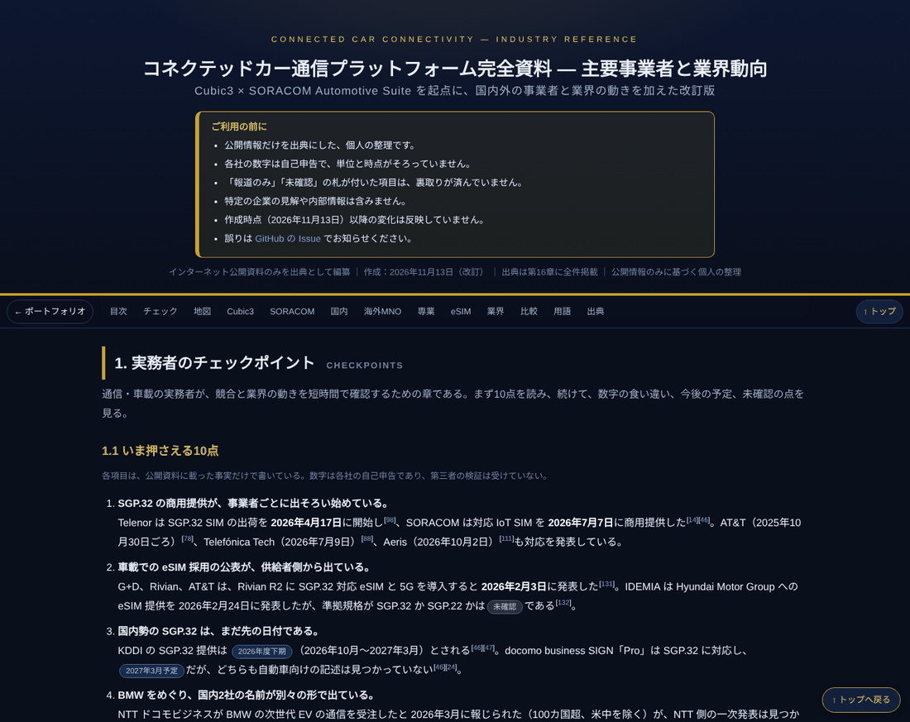
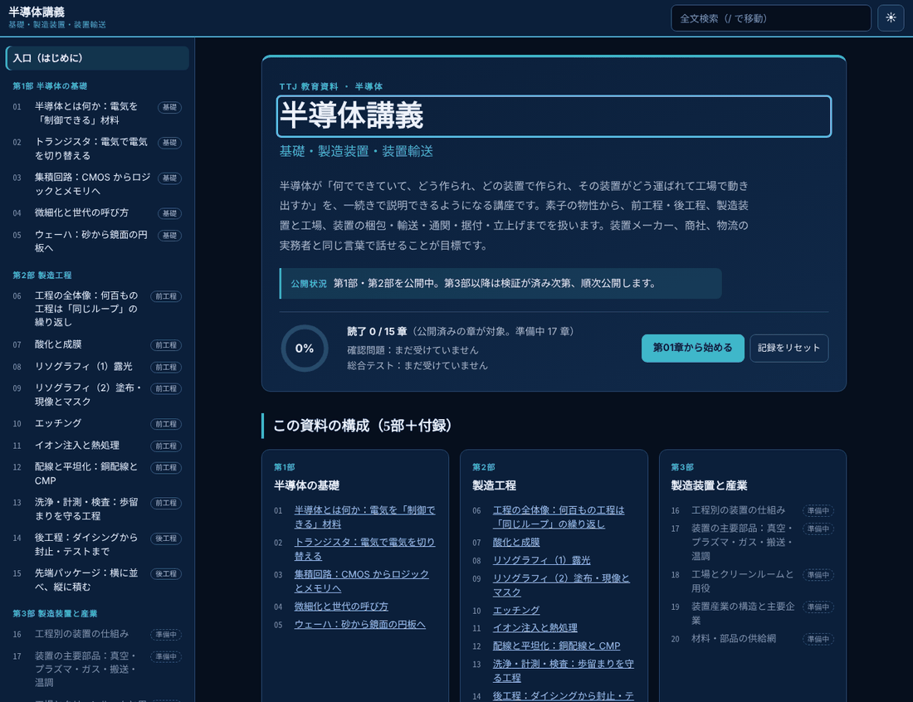
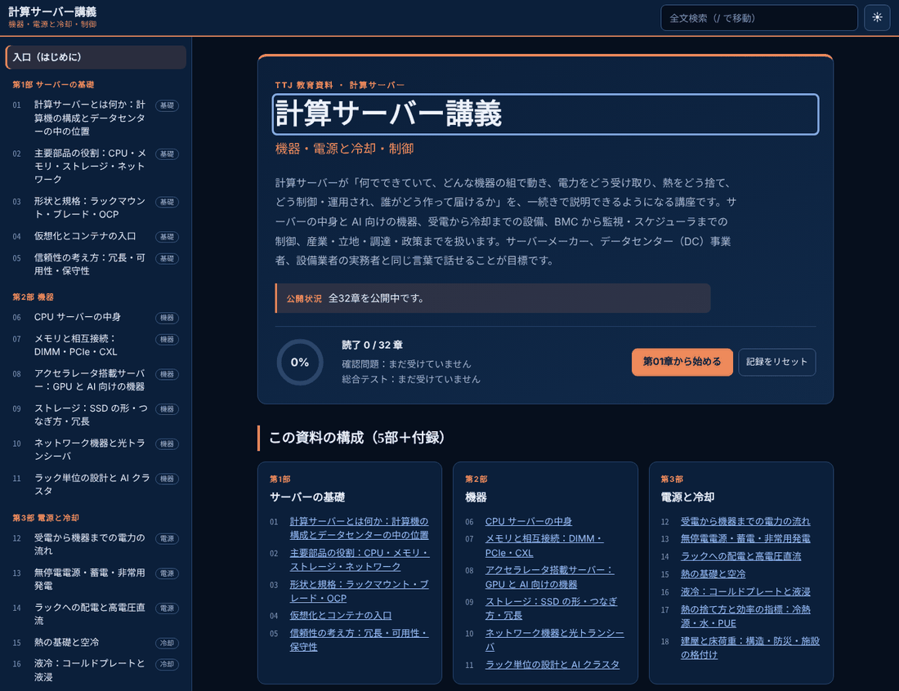

# TTJ AI Ecosystem

AI エージェント × 通信 × 半導体 × 計算サーバー × 発電

作者のこれまでの経験を活かしつつ、Claude Code を軸にした AI 開発環境と、通信・半導体・計算サーバー・発電（コンバインドサイクル発電とガスタービン）を、学べる形にまとめた学習用作品です。講義は、検証の済んだ分から順に公開しています。一部の資料と講義は、公開資料を出典に企業名を挙げて整理しています。

**[▶ デモを見る（ショーケース）](https://tetsuyaoyama.github.io/ttj-ai-ecosystem-/showcase/)**



## 分野の一覧

1. AI・開発環境（Claude Code）
2. 通信
3. 半導体
4. 計算サーバー
5. 自作PC（準備中）
6. 発電・ガスタービン（準備中）

## 作品

### 1. AI・開発環境

#### AI エコシステム図

このリポジトリの Claude Code 構成（入口・ハーネス・振り分け・公開）をインタラクティブに図解します。

[デモを開く](https://tetsuyaoyama.github.io/ttj-ai-ecosystem-/showcase/ai-ecosystem/)



### 2. 通信

[](https://tetsuyaoyama.github.io/ttj-ai-ecosystem-/showcase/learning-map/)

**学習全体マップ** は、通信の講義室（55章）とコアネットワーク講義（34章）を、通信の流れ（横）と習熟の段（縦）で1枚に並べた地図です。点を押すと該当の章へ移動し、読了の状況も反映されます。

- **[▶ 学習全体マップを開く](https://tetsuyaoyama.github.io/ttj-ai-ecosystem-/showcase/learning-map/)**

#### 通信の講義室 ― eSIM・IoT 実務大全

全55章・14部の独習教材です。eSIM/RSP、VoLTE・SMS、IoT/車載の実務、セキュリティ、IMEI までを、ラボ・ログ演習・理解度チェック付きで学べます。

[デモを開く](https://tetsuyaoyama.github.io/ttj-ai-ecosystem-/showcase/sdv-dojo/)



#### コアネットワーク講義 ― 4G EPC / 5G 5GC

全34章の独習教材です。4G EPC と 5G 5GC のノード・インタフェース・識別子・手順を対にして学びます。構成図、シーケンス再生、識別子の解剖、鍵階層、状態遷移、切り分け演習、確認問題付きです。

[デモを開く](https://tetsuyaoyama.github.io/ttj-ai-ecosystem-/showcase/core-network/)



#### eSIM / RSP 解説ツール

SGP.22・SGP.02・SGP.32 の構成を比べ、プロファイルのダウンロード手順をアニメーションで追えます。

[デモを開く](https://tetsuyaoyama.github.io/ttj-ai-ecosystem-/showcase/esim-rsp/)



#### 通信フロー可視化

VoLTE・IMS登録・SMS over SGs/IP・S8HR のシーケンスを、ステップ再生で確認できます。

[デモを開く](https://tetsuyaoyama.github.io/ttj-ai-ecosystem-/showcase/telecom-flows/)



#### コネクテッドカー通信プラットフォーム資料 ― 主要事業者と業界動向

国内外の通信事業者・専業プラットフォーム・eSIM 供給者、約30社と、業界の動き（SGP.32、恒久ローミング、衛星・NTN、NG eCall、2G/3G 停波など）を、公開情報だけを出典に整理した資料です。出典156件、実務者のチェックポイントと比較表つき。個人の整理であり、各社の数字は自己申告で単位と時点がそろっていません。

[資料を開く](https://tetsuyaoyama.github.io/ttj-ai-ecosystem-/showcase/cc-platforms/)



### 3. 半導体

#### 半導体講義 ― 基礎・製造装置・装置輸送

半導体の物性から、製造工程、製造装置、装置の梱包・輸送・据付までを学ぶ講座です。全32章（5部と付録）をすべて公開しています。図を動かせる部品と確認問題、総合テストつき。公開情報だけを出典にしています。

[講座を開く](https://tetsuyaoyama.github.io/ttj-ai-ecosystem-/showcase/semi/)



この講座の元データ（章の HTML・図のデータ・検証記録）と、単一 HTML に組み立てる基盤は `courses/` にあります。`courses/_framework/build.py` が `courses/semi/`（course.json、chapters/、data/）から 1 枚の HTML を作り（`--check` で重複・リンク切れなどを検査、`--publish courses/semi-publish.json` で公開範囲と出力先を指定）、`courses/_framework/test.py` が 1366px・375px、ダーク・ライトで動作を検査します。手順は `courses/PUBLISH.md`、基盤の仕様は `courses/_framework/FRAMEWORK.md`、検証の記録は `courses/semi/REVIEW-*.md` に書いてあります（基盤は Python 3 の標準ライブラリだけで動き、検査には Playwright と node を使います。パスは作者の環境のものなので、置き場所を変えるときは読み替えてください）。

### 4. 計算サーバー

#### 計算サーバー講義 ― 機器・電源と冷却・制御

計算サーバーが何でできていて、どんな機器の組で動き、電力をどう受け取り、熱をどう捨て、どう制御・運用され、誰がどう作って届けるかを学ぶ講座です。全32章（5部と付録）をすべて公開しています。図を動かせる部品と確認問題、総合テストつき。公開情報だけを出典にしています。

[講座を開く](https://tetsuyaoyama.github.io/ttj-ai-ecosystem-/showcase/server/)



この講座の元データ（章の HTML・図のデータ・検証記録）は `courses/server/` にあり、半導体講義と同じ基盤（`courses/_framework/`）で 1 枚の HTML に組み立てます（`courses/_framework/build.py` の `--publish courses/server-publish.json` で公開範囲と出力先を指定）。検証の記録は `courses/server/REVIEW-*.md` です。

### 5〜6. 準備中の分野

- **自作PC**（準備中）
- **発電・ガスタービン**（準備中）：発電事業の仕組みと、コンバインドサイクル発電用ガスタービンを扱う講義。

### その他

#### TTJ 公式サイト

AI の未来レポート、触れる展示、備蓄ガイドなどを収めた TTJ のサイトです。冒頭には恒星のまわりを粒子が回る演出があります。

[サイトを開く](https://ttj.tokyo/)

## このリポジトリの見どころ

- [claude/settings.json](claude/settings.json) — `sudo`・force push・`.env` 読み取りを拒否し、`git push` や `rm` は確認に回す権限ルール。
- [claude/hooks/bash_guard.py](claude/hooks/bash_guard.py) — `rm -rf /` や `curl ... | sh` など、権限ルールで防ぎきれない危険なコマンドを止めるフック。
- [claude/agents/](claude/agents/) — haiku / sonnet / opus / fable の4モデルに作業を振り分けるサブエージェント定義。
- [claude/skills/](claude/skills/) — 公開前レビュー、通信SVG作成、X下書きなど、用途別のスキル7本。
- [design-system/tokens.css](design-system/tokens.css) — 紺×金の TTJ デザイントークン。見本ページ付き。
- [deploy/github-actions/](deploy/github-actions/) — Cloudflare Pages へ自動公開する GitHub Actions ワークフロー。

## 作者

TTJ（TED TRADING JAPAN G.K.）

作者のこれまでの経験を活かしつつ、AI・開発環境、通信、半導体、計算サーバー、発電を、学べる形にまとめた学習用作品です。

TTJ 公式サイト：https://ttj.tokyo/

## セットアップ

ここから下は、この環境を自分の WSL に入れて使うための手順です。

元画像の AI エコシステムを TTJ 向けに置き換えた Claude Code 環境です。
モデル振り分け・フック・権限ルール・スキル・サブエージェントを `~/.claude/` に一括導入します。
全ファイル日本語、WSL2(Ubuntu) 上の Claude Code で使う前提です。

### 1. 全体図

元画像の11列との対応は [docs/ecosystem-map.md](docs/ecosystem-map.md)、設計の詳細は [docs/spec.md](docs/spec.md) を参照してください。

```
人（TTJ）
  ↓ 入口：ターミナル(WSL) / Claudeアプリ / クロ(Discord・任意) / 定期タスク
Claude Code（司令塔 = ~/.claude/）
  ↓ ハーネス：CLAUDE.md・権限ルール・フック8本・記憶メモ・APIキー1か所
振り分け：Codex に頼む / スキル7本 / サブエージェント5体 / 外部API(xAI・OpenAI・Claude)
  ↓
成果物：HTML・SVG・Markdown・X下書き
  ↓ 公開前チェック（checker → codex-review）
公開：GitHub Pages(ttj.tokyo) ＋ Cloudflare Pages
```

### 2. 導入手順（Windows）

1. **WSL2 + Ubuntu を入れる**。管理者権限の PowerShell で `wsl --install -d Ubuntu` を実行し、再起動後に Ubuntu のユーザー名とパスワードを設定する。以降の作業はすべて Ubuntu のターミナル内で行う。
2. **Node.js と Claude Code CLI を入れる**。Node.js は公式手順（nvm など）で導入し、Claude Code は Anthropic の公式手順に従って入れる。`claude --version` で確認する。
3. **リポジトリを取得する**。
   ```bash
   git clone <このリポジトリのURL> ~/ttj-ai-ecosystem
   cd ~/ttj-ai-ecosystem
   ```
4. **インストールする**。
   ```bash
   bash install.sh
   ```
   `claude/` 以下が `~/.claude/` にコピーされます。既存ファイルは `~/.claude/backup-<日時>/` に退避され、`settings.json` は差分を見せて確認します（`-y` で省略可）。記憶メモ `memory/MEMORY.md` と `skills/.env` は既にあれば上書きしません。
5. **APIキーを書く**。`~/.claude/skills/.env` を自分で編集する（Claude はこのファイルを読まない決まり）。キーは `ANTHROPIC_API_KEY` / `OPENAI_API_KEY` / `XAI_API_KEY` / `XAI_MODEL` / `DISCORD_BOT_TOKEN` / `CLOUDFLARE_API_TOKEN` / `CLOUDFLARE_ACCOUNT_ID`。使うものだけ埋めればよい。
6. **起動して動作確認する**。WSL 内で `claude` を起動し、再起動後にフックと権限が効いていることを確かめる（例：`.env` を読ませようとするとブロックされる）。

Codex CLI は OpenAI の公式手順に従って導入してください。入れなくても `codex-review` スキルは reviewer エージェントで代替できます。

### 3. 中身の一覧

- `claude/` — `~/.claude/` に置くもの（CLAUDE.md、settings.json、hooks、agents、skills、memory）
- `design-system/` — 紺×金の TTJ デザイントークン（tokens.css）と見本ページ
- `templates/` — 各リポジトリに置く `project-CLAUDE.md` の雛形
- `bots/` — Grok Bot（X下書き・ニュース要約、定期実行）とクロ（Discord Bot、任意）
- `deploy/` — Cloudflare Pages の導入手順と GitHub Actions ワークフロー

### 4. モデルの使い分け

| 区分 | モデル | 担当 | エージェント |
|---|---|---|---|
| 軽い | haiku | ファイル確認・検索・差分/書式/JSONチェック | scout / checker |
| 方針決定済み | sonnet | 決まった編集・置換・実装・ライティング | builder |
| 判断がいる | opus | 文章/プロンプトの練り直し・レビュー | reviewer / architect |
| 特に重要 | fable | 全体設計・方針決め・複雑な変更・最終確認 | architect（使える環境なら） |

最初から重いモデルを使わず、軽い側で試して必要なら上げます。メインモデルの切り替えは人が行います。

### 5. 安全の仕組み

権限ルール（`settings.json`）とフック（`hooks/*.py`）で、次のものが止まるか確認になります。

- **拒否**：`sudo`、`git push --force` / `-f`、`.env`・`*.pem` の読み取り
- **フックでブロック**：`rm -rf /`・`rm -rf ~`、`--force-with-lease`、`.env` を cat/grep 等で読む操作、`curl ... | sh`、`id_rsa` 系の読み取り
- **確認が出る**：`git push`、`git reset --hard`、`rm`、`npx wrangler`（deploy 以外）、`gh`

止められたときは Claude に回避させず、**人が自分のターミナルで実行**してください。

### 6. 各リポジトリへの適用

- **CLAUDE.md**：`templates/project-CLAUDE.md` を ttj.tokyo などのリポジトリ直下に `CLAUDE.md` としてコピーし、内容をそのサイト用に書き換える。
- **Cloudflare**：`deploy/github-actions/deploy-cloudflare-pages.yml` をサイトのリポジトリの `.github/workflows/` にコピーし、Secrets（`CLOUDFLARE_API_TOKEN`、`CLOUDFLARE_ACCOUNT_ID`）と Variables（`CF_PAGES_PROJECT`）を登録する。詳細は [deploy/cloudflare/README.md](deploy/cloudflare/README.md)。
- **Bot**：[bots/grok-bot/README.md](bots/grok-bot/README.md)、[bots/kuro-discord-bot/README.md](bots/kuro-discord-bot/README.md) を参照。

### 7. よくある質問

- **フックが動かない**：フックは `python3` が必要です。`python3 --version` で確認し、無ければ `sudo apt install python3`。インストール後に Claude Code を再起動する。
- **Windows ネイティブで動かしていい？**：いけません。PowerShell ではなく、WSL の Ubuntu 内で `claude` を起動してください（フックとパスが WSL 前提）。
- **設定が反映されない**：Claude Code を再起動する。`settings.json` を維持した場合は新しい設定が入っていないので、`bash install.sh` をやり直して上書きを承認する。
- **上書きされた設定を戻したい**：`~/.claude/backup-<日時>/` から戻す。
- **Claude が .env を読めない**：仕様です。キーは自分で編集し、必要な処理はスクリプトが自分で読みます。
- **cron が動かない（Grok Bot）**：WSL では `sudo service cron start` が必要なことがあります。確実に回すなら Windows タスクスケジューラを使う（bots/grok-bot/README.md）。
